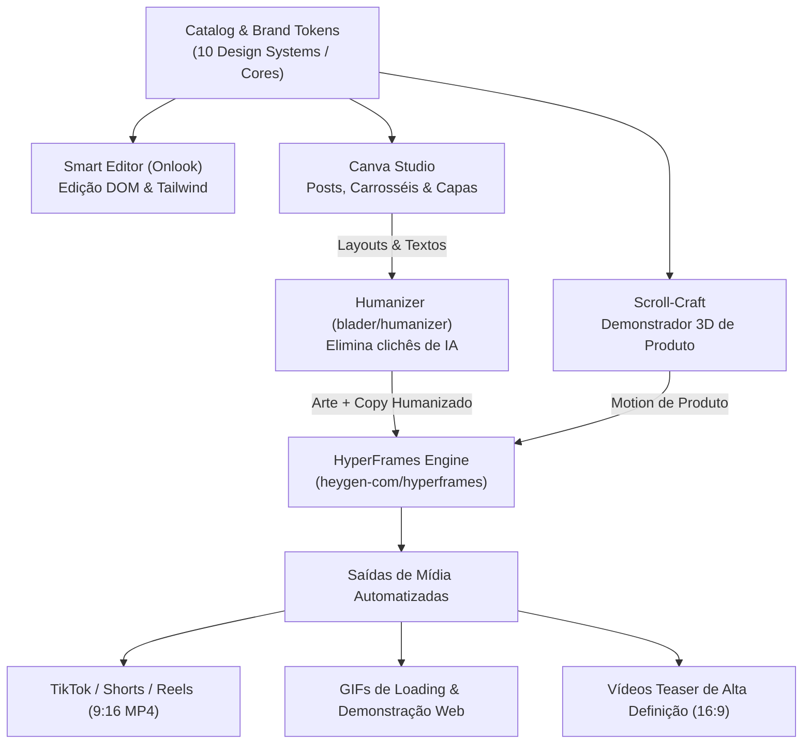

# Hyperframes: Análise de Viabilidade Técnica e Integração ao DesignSystemPro

**Documento de Engenharia & Decisão de Arquitetura**  
**Projeto:** DesignSystemPro / AI Design System Agent  
**Data:** 11 de Novembro de 2026  
**Status:** Análise Concluída · **Recomendação: Incorporação Faseada (Alto Valor)**

---

## 1. Resumo Executivo & Veredito

> **Veredito:** **SIM, vale a pena incorporar o HyperFrames (`heygen-com/hyperframes`).**  
> O HyperFrames preenche a lacuna exata entre o design visual estático (Canva Studio / Figma) e o código interativo web (Scroll-Craft / Onlook), fornecendo um motor **agent-native** capaz de converter HTML, CSS, Tailwind e GSAP diretamente em vídeos MP4 e GIFs de alta definição sem a complexidade de compilação React exigida pelo Remotion.

### Por que ele se encaixa perfeitamente no ecossistema atual?
1. **Agent-Native por Design:** Ao contrário do Remotion (que exige da IA conhecimento profundo de ciclo de vida React, hooks proprietários como `useCurrentFrame()` e serialização de componentes), o HyperFrames consome **HTML, CSS e animações cronometradas padrão da web (GSAP / CSS Keyframes / WebGL)** — exatamente o formato em que LLMs como Gemini Flash, Claude e GPT possuem a maior taxa de acerto do mercado.
2. **Complemento direto ao Canva Clone:** O nosso Canva Studio já define camadas, textos, badges, imagens e paletas de cores. O HyperFrames permite que o usuário aperte um botão como **"Transformar em Vídeo/Shorts"**, gerando animação de entrada com keyframes cronometrados e exportando um arquivo `.mp4` para TikTok/Reels ou um `.gif` otimizado.
3. **Poder para Shaders & 3D:** Suporta Three.js, shaders GLSL e canvas HTML com renderização determinística quadro a quadro (sem perda de frames por lag de CPU/GPU).

---

## 2. O que é o HyperFrames (`heygen-com/hyperframes`)?

Desenvolvido pela equipe de engenharia da **HeyGen**, o HyperFrames é um framework open-source concebido especificamente para a era dos **Agentes Autônomos de Código (AI Coding Agents)**.

### Como ele funciona:
```
┌────────────────────────────────────────────────────────┐
│  AI Agent Prompt / Layout do Canva Studio / Scroll-Craft│
└───────────────────────────┬────────────────────────────┘
                            │ Gera HTML + CSS + GSAP
                            ▼
┌────────────────────────────────────────────────────────┐
│         Composição Web Declarativa (Vite Preview)       │
│  - Timeline temporal (segundos ou frames)              │
│  - Shaders WebGL / Three.js / Canvas 2D                │
│  - Áudio sincronizado & Efeitos Sonoros                │
└───────────────────────────┬────────────────────────────┘
                            │ CLI: npx hyperframes render
                            ▼
┌────────────────────────────────────────────────────────┐
│   Headless Chromium + Renderizador Determinístico      │
│  - Captura quadro a quadro (sem pular frames de lag)   │
│  - Compressão FFmpeg integrada                         │
└───────────────────────────┬────────────────────────────┘
                            │ Saída Final
                            ▼
        [ MP4 Video (1080p/4K) ]  ou  [ GIF Animado ]
```

### Principais Características:
- **Skill Oficial para Agentes de IA:** Disponível via `npx skills add heygen-com/hyperframes`, ensinando o agente a planejar sequências de corte, tempos de entrada, tipografia cinética e transições de cena.
- **Renderização Determinística:** Ao gravar um vídeo tradicional na web com captura de tela (WebRTC), se o computador tiver uma oscilação de CPU, o vídeo fica travado ou dessincronizado. O HyperFrames controla o relógio interno do navegador: cada quadro só avança quando o DOM estiver 100% renderizado.
- **Padrões Abertos da Web:** Nada de sintaxes fechadas. Uma transição de texto é simplesmente um `gsap.from(".title", { duration: 0.8, opacity: 0, y: 50 })` ou uma animação CSS.

---

## 3. Matriz Comparativa: HyperFrames vs. Remotion vs. Scroll-Craft vs. Canva Studio

| Critério | **HyperFrames** (`heygen-com`) | **Remotion** (`remotion-dev`) | **Scroll-Craft** (`nateherkai`) | **Canva Studio** (Atual) |
| :--- | :--- | :--- | :--- | :--- |
| **Foco Primário** | Vídeos e GIFs gerados por IA via HTML/CSS/GSAP | Vídeos programáticos complexos em React | Páginas interativas com scroll e 3D | Criação visual de posts, carrosséis e banners |
| **Linguagem Base** | HTML5, CSS3, GSAP, WebGL | React 19, TypeScript, TSX | HTML, CSS, Three.js, Canvas | SVG, JSON Tokens, Canvas HTML5 |
| **Facilidade para LLM** | ⭐⭐⭐⭐⭐ **Altíssima** (HTML puro é nativo de qualquer IA) | ⭐⭐⭐ **Média** (Erros comuns em hooks e types) | ⭐⭐⭐⭐ **Alta** (Gramáticas de página pré-definidas) | ⭐⭐⭐⭐⭐ **Altíssima** (Templates declarativos) |
| **Preview ao Vivo** | Vite Live-Reload (Instantâneo no navegador) | Player React (`@remotion/player`) | Navegação nativa no browser | Canvas DOM interativo com zoom |
| **Formato de Saída** | MP4 (H.264), WebM, GIF, PNG Sequence | MP4, ProRes, WebM, GIF, Áudio | Código HTML/React para Landing Pages | PNG, JPEG, SVG Penpot, Tokens Figma |
| **Custo de Renderização** | Leve a Médio (Chromium Headless + FFmpeg) | Médio a Alto (Node SSR + Chromium + React) | Zero (Renderiza no cliente final do site) | Zero (Canvas nativo do browser) |
| **Consumo de Memória** | ~150MB a 400MB durante render | ~300MB a 800MB durante render | Apenas navegador do usuário | Apenas navegador do usuário |

---

## 4. Como o HyperFrames Trabalha em Conjunto com o DesignSystemPro

A grande vantagem de incorporar o HyperFrames não é substituir o que já temos, mas sim **orquestrar as ferramentas existentes como uma esteira completa de design e mídia**:



### 1. Sinergia com o Canva Studio (Clone Canva)
- O usuário projeta um post ou story estático no **Canva Studio** (como o template "Somos Pet Friendly" ou o anúncio de tecnologia).
- Com um clique em **"Gerar Vídeo com HyperFrames"**, o agente analisa os elementos do Canvas (faixa inclinada, título, badge de preço estrela, foto do pet, amenities) e cria uma timeline no HyperFrames:
  - **0.0s - 0.8s:** Fundo e onda superior entram com fade suave.
  - **0.8s - 1.5s:** Faixa "SOMOS" cai com spring e o título "PET FRIENDLY" expande.
  - **1.5s - 2.5s:** Selo de preço estrela entra girando; itens da lista entram em cascata com som de clique.
  - **2.5s - 5.0s:** Foto do pet ganha leve zoom cinemático (efeito Ken Burns) e número de telefone brilha.
- **Resultado:** O que era um post estático vira um Reels/TikTok pronto para rodar anúncios com alto engajamento!

### 2. Sinergia com o Scroll-Craft
- O **Scroll-Craft** cria demonstrações 3D interativas em sites onde o produto gira conforme o usuário rola a página.
- Porém, clientes precisam de vídeos pré-renderizados para enviar no WhatsApp, exibir em telões de eventos ou patrocinar no Instagram.
- O HyperFrames pega o mesmo código Three.js/Canvas do Scroll-Craft e grava a trajetória da câmera automaticamente de 0% a 100% da timeline, gerando um MP4 impecável sem nenhuma queda de frame.

### 3. Sinergia com o Humanizer
- Roteiros e textos de vídeo frequentemente soam engessados ou repetitivos quando gerados por IA pura.
- O `humanizer.ts` processa as legendas, headlines e narrações antes de passá-las para o HyperFrames, garantindo ganchos naturais que retêm o público nos primeiros 3 segundos.

### 4. Sinergia com o Remotion (Diferenciação de Papéis)
- **Remotion:** Fica reservado para o preview interativo imediato dentro da UI do Next.js via `@remotion/player` (já instalado no projeto).
- **HyperFrames:** Atua como o **motor CLI de exportação de alta fidelidade e animação por agentes**, permitindo que o usuário digite no chat:  
  *`"Gere uma animação em GIF de 3 segundos para a tela de carregamento da loja de joias com o logo da Van Cleef brilhando"`*  
  O agente escreve o HTML/CSS/GSAP da animação e o HyperFrames cospe o `.gif` ou `.mp4` diretamente na pasta de assets do projeto!

---

## 5. Casos de Uso Concretos para a Aplicação

### Caso 1: Geração de Vídeos Curtos Verticais (TikTok, Shorts, Reels)
- **Formato:** 1080 × 1920 (9:16), 30 ou 60 FPS, duração de 7 a 15 segundos.
- **Aplicações:**
  - Vídeos no estilo "Gancho Viral": *"3 Erros que você comete na sua loja online"* com animação de texto dinâmico estilo CapCut.
  - Demonstração rápida de novos produtos com transição de fotos e preço em destaque.

### Caso 2: GIFs Animados de Demonstração e Loading Screens
- **Formato:** 400 × 400 ou 800 × 600 GIF em loop perfeito.
- **Aplicações:**
  - Telas de carregamento elegantes para as 10 categorias de lojas (diamantes girando para joias, engrenagens para relógios, carrinho acelerando para e-commerce).
  - Micro-animações para documentação de componentes do design system (ex: demonstração de um dropdown, modal ou botão interativo).

### Caso 3: Banners Animados para Anúncios (Display & Feed)
- **Formato:** 1200 × 630 (Facebook) ou 300 × 250 (Google Ads Display).
- **Aplicações:**
  - Anúncios com contagem regressiva de Black Friday ("Oferta expira em 3 horas").
  - Troca dinâmica de cores de produto (ex: bolsa Polène mudando de cor a cada 2 segundos).

---

## 6. Arquitetura de Implementação Técnica Recomendada

Para adicionar o HyperFrames sem poluir ou quebrar o Next.js atual, a arquitetura ideal é uma pasta dedicada de orquestração:

```
f:\Projetos2026\DesigSystemPro\
├── ai-design-system-agent\
│   ├── src\
│   │   ├── lib\
│   │   │   ├── hyperframes.ts          <-- [Novo] Orquestrador e gerador de templates
│   │   │   ├── canva-engine.ts         <-- Integração de elementos com animação
│   │   │   ├── remotion-player.tsx     <-- Preview visual em tempo real
│   │   ├── components\
│   │   │   ├── studio\
│   │   │   │   ├── HyperframesStudio.tsx <-- Aba/Modal de exportação de vídeo
│   ├── templates-motion\               <-- Composições HTML/CSS/GSAP prontas
│   │   ├── viral-hook-9x16\
│   │   ├── product-showcase-16x9\
│   │   ├── loading-spinners-gif\
```

### Exemplo de Composição HTML/GSAP consumida pelo HyperFrames:
```html
<!DOCTYPE html>
<html>
<head>
  <style>
    body { margin: 0; width: 1080px; height: 1920px; background: #0f172a; color: white; font-family: 'Inter', sans-serif; display: grid; place-items: center; overflow: hidden; }
    .badge { background: #d7f76b; color: #000; padding: 12px 32px; border-radius: 99px; font-weight: 900; font-size: 28px; }
    .title { font-size: 88px; font-weight: 900; text-align: center; line-height: 1.1; margin-top: 40px; }
    .card { width: 880px; height: 500px; background: #1e293b; border-radius: 32px; margin-top: 60px; }
  </style>
  <script src="https://cdnjs.cloudflare.com/ajax/libs/gsap/3.12.2/gsap.min.js"></script>
</head>
<body>
  <div>
    <div class="badge">✦ LANÇAMENTO 2026</div>
    <div class="title">DESIGN QUE TRANSFORMA<br>O SEU RESULTADO</div>
    <div class="card"></div>
  </div>

  <script>
    // Timeline que o HyperFrames controla deterministicamente
    const tl = gsap.timeline();
    tl.from(".badge", { scale: 0, opacity: 0, duration: 0.6, ease: "back.out(1.7)" })
      .from(".title", { y: 60, opacity: 0, duration: 0.8, ease: "power3.out" }, "-=0.2")
      .from(".card", { y: 100, opacity: 0, duration: 0.8, ease: "power2.out" }, "-=0.4");
  </script>
</body>
</html>
```

---

## 7. Prós, Desafios e Cuidados Operacionais

### Vantagens:
- **Independência de frameworks pesados:** Não precisa compilar React ou empacotar pacotes complexos para gerar um vídeo; basta criar um HTML limpo com CSS.
- **Portabilidade:** As animações geradas rodam nativamente em qualquer navegador, podendo ser reaproveitadas diretamente no frontend da loja ou salvas como vídeo.
- **Qualidade de Exportação:** Renderização sem compressão precoce, com áudio multiplexado e suporte a resolução 4K vertical.

### Desafios a considerar:
- **Dependência do Chromium & FFmpeg:** A renderização final em MP4 requer que o ambiente tenha o headless Chrome e o binário do FFmpeg acessíveis. (No Windows, o `npx hyperframes` baixa automaticamente as dependências ou usa o Edge/Chrome já instalado).
- **Tempo de Renderização:** Enquanto o preview HTML/Vite é imediato (60fps), a renderização de um vídeo de 15 segundos em 1080p pode levar de 10 a 25 segundos na CPU.

---

## 8. Roteiro de Adoção Sugerido

1. **Fase 1 (Pronta):** Manter o Canva Clone para criação gráfica, o Scroll-Craft para páginas 3D e o Remotion para previews em React.
2. **Fase 2 (Próxima Iteração):** Adicionar o pacote `hyperframes` e criar um botão no Canva Studio chamado **"Exportar como Vídeo Animado (HyperFrames)"**.
3. **Fase 3:** Integrar a biblioteca de templates de vídeo verticais (Shorts/Reels) com o `humanizer.ts` gerando o copy narrado e as legendas animadas em sincronia.

---

## 9. Conclusão

A incorporação do **HyperFrames** é uma evolução natural e altamente estratégica para o **DesignSystemPro**. Ele une o poder do estúdio visual com a capacidade de entregar ativos de marketing dinâmicos (vídeos, reels, GIFs e teasers) que o cliente moderno de e-commerce e tecnologia exige, tornando o agente uma solução completa de ponta a ponta: do código do site ao criativo em vídeo para redes sociais.

